# 小説 整形・校正ツール

Notionで書いた小説を、**Notionで見えているとおりの改行のまま**pixivなどに貼り付けるためのツールです。
あわせて、三点リーダーや句読点など、小説の表記ルールに沿っていない箇所をチェックできます。

👉 **ツールを開く：https://hano2552550-web.github.io/novel-tool/**

- 無料・登録不要。ブラウザで開くだけで使えます。
- **本文は外部に一切送信されません。** 処理はすべて、お使いのパソコンのブラウザの中で行われます。

---

## こんなことに困っていませんか？

Notionからコピーした本文をpixivに貼ると、**すべての行のあいだに空行が入って1行おき**になってしまいます。
しかも、場面転換のために入れた空行は、逆に消えてしまいます。

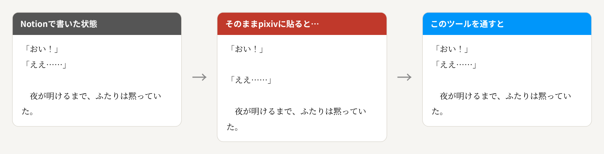

このツールを通すと、Notionで書いた状態がそのまま再現されます。

---

## 使い方

### 1. ツールを開く

[ツールのページ](https://hano2552550-web.github.io/novel-tool/)を開きます（パソコンの **Chrome** または **Edge** がおすすめです）。

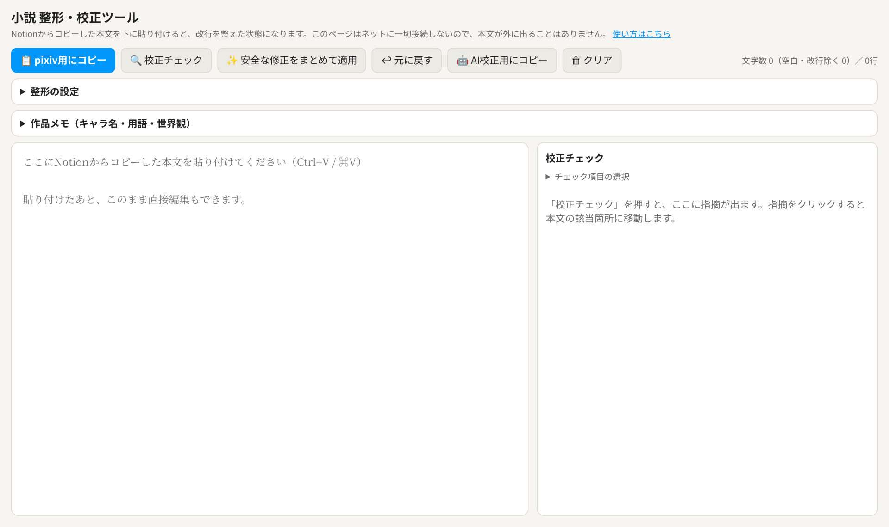

### 2. Notionからコピーして貼り付ける

Notionで本文を選択してコピー（`Ctrl+C` / Macは `⌘+C`）し、ツールの大きな入力欄に貼り付けます（`Ctrl+V` / `⌘+V`）。
画面下に「Notionの改行・空行をそのまま再現して貼り付けました」と出れば成功です。

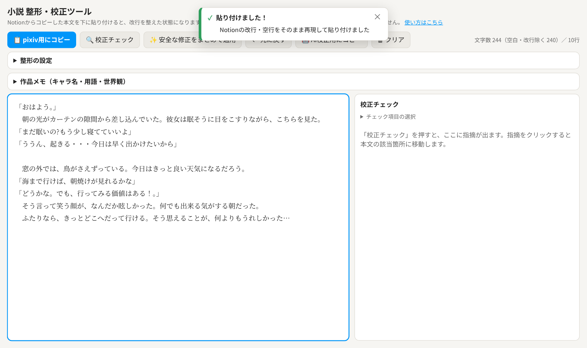

> 貼り付けたあとは、入力欄の中で直接文章を直すこともできます。

### 3. 校正チェック（必要なときだけ）

「🔍 校正チェック」を押すと、右側に気になる箇所の一覧が出ます。

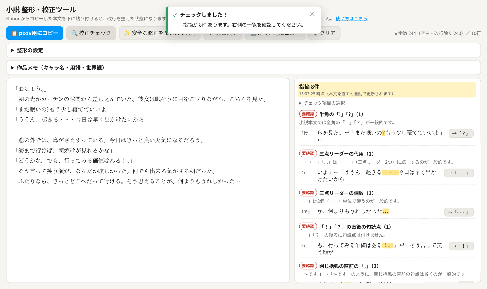

- 指摘をクリックすると、本文の該当箇所が選択されます。
- 「→」のボタンを押すと、その箇所だけ修正されます。
- **要確認**は直したほうがよいもの、**参考**は意図的ならそのままでよいものです。

### 4. まとめて直す

「✨ 安全な修正をまとめて適用」を押すと、機械的に直して問題ない箇所（`・・・`→`……`、`。」`→`」` など）を一度に直します。

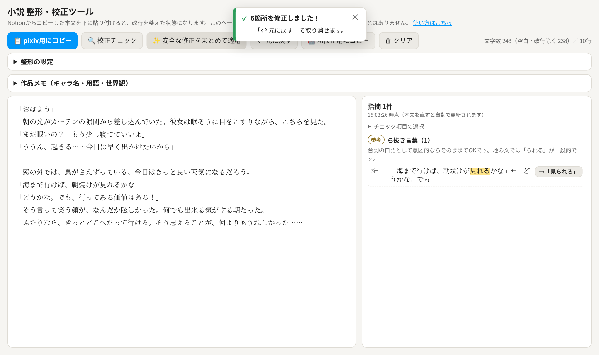

間違えても「↩ 元に戻す」で元の状態に戻せます。

### 5. pixiv用にコピーして投稿

「📋 pixiv用にコピー」を押して、pixivの投稿画面に貼り付ければ完了です。

### 実行結果のお知らせ

ボタンを押すと、画面上部に結果が表示されます。

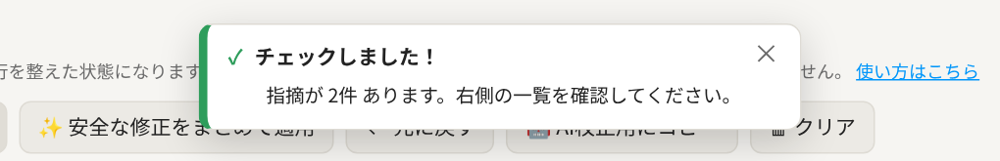

うまくいかなかったときは、**原因**と**対処法**が表示されます。

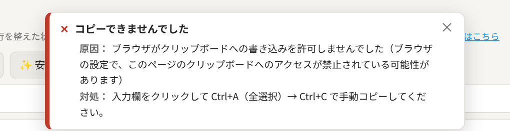

---

## チェックできる項目

| 項目 | 例 |
|---|---|
| 閉じ括弧の直前の句点・読点 | `「です。」` → `「です」` |
| 「！」「？」の後の全角スペース | `本当？嘘だ` → `本当？　嘘だ` |
| 「！」「？」の後の句読点 | `！。` → `！` |
| 半角の「!」「?」 | `!` → `！` |
| 三点リーダーの表記と個数 | `・・・` `...` `…` → `……` |
| ダッシュの表記 | `—` `─` → `――` |
| 句読点の重複 | `、、` `。、` |
| 助詞の重複（打ち間違い） | `をを` `のの` |
| 言葉のくり返し | 「ただただかわいい。ただそれに…」の「ただ」など、同じ文・隣の文での重複 |
| 誤用・誤変換 | `的を得る` → `的を射る`、`見ずらい` → `見づらい`、`こんにちわ` → `こんにちは` など |
| 重ね言葉 | `頭痛が痛い` `後で後悔` `違和感を感じる` など |
| 同じ文末の連続 | 地の文で「〜いた。」が3文以上続く など |
| 作品メモの名前の打ち間違い | `ひかりり`（登録名「ひかり」）、ひらがな／カタカナ違い |
| ら抜き言葉 | `見れる` → `見られる` |
| 括弧の閉じ忘れ | `「` が閉じていない |
| 字下げの不統一、鉤括弧の行の字下げ | |
| 表記ゆれ | `出来る` と `できる` の混在 など |
| 半角カタカナ、日本語の間の半角スペース | |
| 長すぎる一文（120字超） | |

> 文脈を読まないと判断できない誤変換（「以上／異常」など）や、文としての不自然さは、ツールのルールでは見つけきれません。そうした箇所は「🤖 AI校正用にコピー」でAIにも確認してもらうのがおすすめです。

チェックする項目は、右側の「チェック項目の選択」でオン・オフを切り替えられます（設定はブラウザに保存されます）。

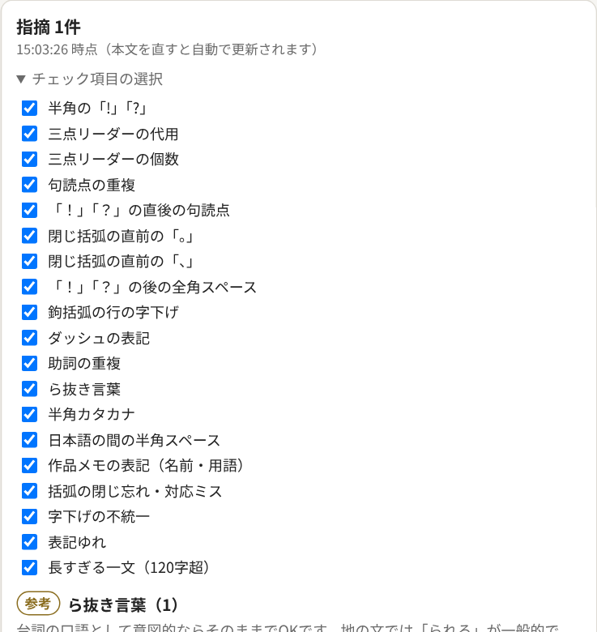

---

## 作品メモ（キャラ名・用語・世界観）

作品ごとに、登場人物の名前・呼び方・用語・世界観をメモしておけます。
メモを使うと、校正の精度が上がります。

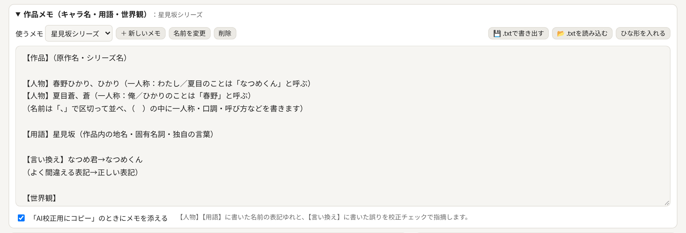

1. 「作品メモ」を開いて「＋ 新しいメモ」を押し、原作名やシリーズ名を付けます。
2. 「ひな形を入れる」を押すと書き方の例が入るので、自分の作品に合わせて書き換えます（「🗑 クリア」で内容を消せます。直後ならCtrl+Zで元に戻せます）。
   - `【人物】` `【用語】`：名前や用語を「、」で区切って並べます。（　）の中は自由なメモです。
   - `【言い換え】`：`よく間違える表記→正しい表記` の形で書きます。
   - `【世界観】`：自由に書けます。
3. 校正チェックをすると、**登録した名前の表記ゆれ**（ひらがな／カタカナ違いなど）と、**言い換えで決めた言葉**を指摘します。

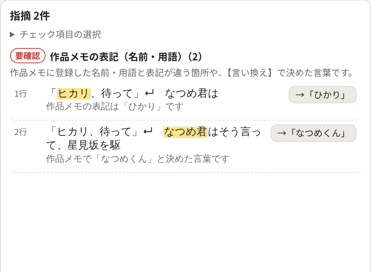

4. 「AI校正用にコピー」を押すと、メモも依頼文に添えられます。AIが名前を誤字と勘違いしにくくなり、呼び方の矛盾などにも気づきやすくなります。

### 別の作品でも同じ設定を使う

- 「💾 .txtで書き出す」で、メモをテキストファイルとして保存できます。
- 同じ原作の別の作品を書くときや、別のパソコン・ブラウザで使うときは、「📂 .txtを読み込む」でそのまま読み込めます。
- 書き出したファイルは普通のテキストなので、メモ帳などで直接編集することもできます。

> メモはお使いのブラウザの中にだけ保存され、外部には送られません。ブラウザのデータを消すとメモも消えるので、大事なメモは書き出して保存しておくと安心です。

---

## 整形の設定

ツール上部の「整形の設定」で、貼り付け時の動きを変えられます。

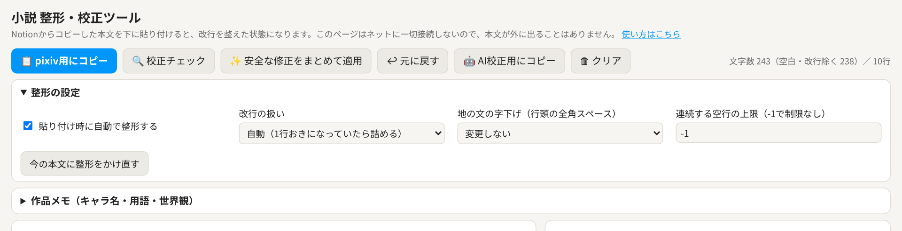

- **改行の扱い**：普段は「自動」のままで大丈夫です。Notion以外から貼り付けて1行おきになるときは「空行を半分に詰める」を試してください。
- **地の文の字下げ**：行頭に全角スペースを付ける／外すを一括で行えます（「」で始まる台詞の行には付けません）。
- **連続する空行の上限**：空行が続きすぎるのを防ぎます。

---

## 仕上げはAIで誤字脱字チェック

このツールの校正チェックは、決まった形の誤りを見つける**一次チェック**です。
「表情に**でで**る」のような打ち間違い、「根本／根元」のような文脈しだいの変換ミス、文法の誤りは、ルールでは見つけきれません。仕上げにAIで確認するのがおすすめです。

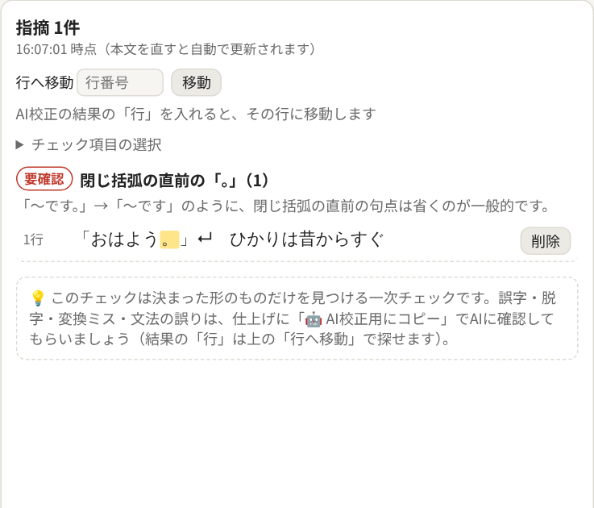

1. 「🤖 AI校正用にコピー」を押します。誤字脱字・変換ミス・文法ミスを優先して探す依頼文と、**行番号つきの本文**（作品メモを使っていればメモも）がまとめてコピーされます。
2. ClaudeなどのAIに貼り付けて送ります。指摘が「行・該当箇所・修正案・種類・理由」の表で返ってきます。
3. 指摘の「行」の数字を、ツール右側の「**行へ移動**」に入れて Enter を押すと、その行が選択されます。そのまま直してください。

> ⚠️ AIに貼り付けた時点で、本文はそのAIサービスに送られます（ツール内のチェックは外部に送られません）。
> 性的な描写などを含む本文は、AIサービスによっては校正を断られる場合があります。

---

## ネットにつながずに使う（オフライン版）

ツールは `index.html` というファイル1つでできています。このファイルをパソコンに保存しておけば、**インターネットにつながっていなくても全機能が使えます**。

### 1. ファイルを保存する（最初の1回だけネットが必要）

1. このページの上部にあるファイル一覧から `index.html` をクリックします。
2. 右上の「⬇」（Download raw file）ボタンを押します。
3. `index.html` がダウンロードフォルダに保存されます。わかりやすい場所（デスクトップなど）に移しておくと便利です。ファイル名は変えても構いません（例：`小説整形ツール.html`）。

### 2. 開いて使う

保存したファイルをダブルクリックすると、ブラウザ（Chrome・Edge推奨）でツールが開きます。使い方はWeb版と同じです。

### 3. 本当に通信していないか確かめたいとき（任意）

ケーブルを抜いたりWi-Fiを切ったりしなくても、Chromeの機能でそのタブだけをオフラインにして試せます。

1. ツールを開いたタブで **F12** キーを押し、開発者ツールを開きます。
2. 上部の「**ネットワーク**（Network）」タブを選びます。
3. 「スロットリングなし（No throttling）」のプルダウンを「**オフライン**（Offline）」に変えます。
4. この状態で、貼り付け・校正チェック・コピー・作品メモの書き出しなどを試します。

「ネットワーク」タブの一覧に通信が増えないことからも、外部に何も送っていないことが確かめられます。開発者ツールを閉じると、オフラインの設定は元に戻ります。

### 注意点

- **作品メモと設定は、Web版とオフライン版で別々に保存されます。** ブラウザが「別のページ」として扱うためです。Web版で書いたメモをオフライン版で使うときは、Web版で「💾 .txtで書き出す」→オフライン版で「📂 .txtを読み込む」で移してください。
- **ツールが更新されても、保存したファイルは自動では新しくなりません。** 新しい機能を使いたいときは、1の手順でもう一度ダウンロードしてください（作品メモは同じ場所のファイルで開けば引き継がれます）。
- 「🤖 AI校正用にコピー」は、コピーまではオフラインでもできます。貼り付け先のAIを使うときにはネットが必要です。

---

## よくある質問

**Q. 本文がどこかに送られたり、保存されたりしませんか？**
A. されません。このツールは外部と通信できないように設定されており、本文はお使いのブラウザの中だけで処理されます。保存されるのはチェック項目のオン・オフなどの設定だけです。

**Q. ネットにつながっていなくても使えますか？**
A. 使えます。[index.html](index.html) を保存しておけば、ダブルクリックで開くだけでオフラインでも全機能が使えます。手順は「[ネットにつながずに使う（オフライン版）](#ネットにつながずに使うオフライン版)」をご覧ください。

**Q. Notionの空行が再現されません。**
A. Chrome または Edge で開いてください。ほかのブラウザでは、Notionの空行の情報を受け取れないことがあります。

**Q. スマホでも使えますか？**
A. 画面は表示できますが、Notionからのコピー＆貼り付けはパソコンでのご利用をおすすめします。

**Q. pixiv以外（ぷらいべったーなど）でも使えますか？**
A. 使えます。「pixiv用にコピー」は普通のテキストとしてコピーするだけなので、ほかのサイトにも貼り付けられます。

---

## フィードバック・不具合報告

不具合のご報告、使い方の質問、機能のご要望は、[フィードバックフォーム](https://docs.google.com/forms/d/e/1FAIpQLSdpWWd7MK2q0u5Au-3xHVOrL-j88KVaN6KFAseBAIou_LjZmw/viewform)からお気軽にどうぞ（匿名・ログイン不要）。
ツール画面の上部にある「💬 フィードバック・不具合報告」からも開けます。

貼り付けがうまくいかない場合は、ツールの「整形の設定」→「🩺 貼り付けの診断情報をコピー」で取れる内容をフォームに貼っていただくと、原因を調べやすくなります（本文は含まれません）。

---

## ライセンス

MIT License。どなたでも自由に使用・改変・再配布できます。
